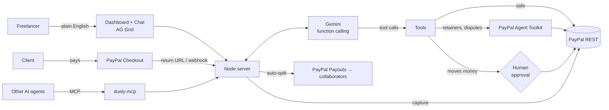

# Duely: the AI agent that gets freelancers paid

**Tell it who to bill in plain English. Duely creates a real PayPal payment request, writes the message to your client, captures the money the moment they pay, auto-splits earnings with your collaborators through PayPal Payouts, sets up monthly retainers with PayPal's official Agent Toolkit, and chases late payers for you. And because it speaks MCP, other AI agents can bill and pay through it too, with you approving every payout.**

> **Judges:** the hosted demo runs on Render's free tier, so the first load after a quiet period can take about a minute while it wakes up.

Built for the *Build What's Next with PayPal and AI* hackathon.

> "Bill Ravi $450 for 3 landing pages, due Friday. Priya gets 30%."
>
> → PayPal order created · pay link + WhatsApp message ready · Ravi pays · payment captured · **$135 sent to Priya automatically via PayPal Payouts**

---

## Why

Freelancers and tiny studios lose hours every month on the money side of their work: writing invoices, sending links, chasing clients who "forgot", and paying their collaborators a share once the client finally pays. Splitting revenue is especially painful: you wait for the client, then manually send each collaborator their cut.

Duely is an **agent** that runs that whole loop on PayPal. You give it intent; it moves money, with a human-in-the-loop confirmation on anything that sends funds out.

## What it does

| Feature | How it works |
|---|---|
| **Chat-to-bill** | Gemini extracts client, line items, quantities, prices, currency, due dates ("Friday", "in 10 days"), phone and splits, then calls `create_payment_request` → a **PayPal Orders v2** order with itemized breakdown |
| **Client pay page** | Every request gets a branded invoice page (`/pay/:id`) with a **Pay with PayPal** button; WhatsApp / email share buttons with a pre-written message |
| **Auto-capture** | PayPal redirects the client back → Duely **captures** immediately. A background poller and **PayPal webhooks** (signature-verified) catch anything the redirect misses. Idempotent: safe under races |
| **Auto-split payouts** | Revenue shares ("Priya gets 30%") are confirmed once at creation, then paid **automatically via PayPal Payouts** the instant the client's payment completes. Payout batch status is tracked to COMPLETED |
| **AI payment chasing** | "Chase Acme" → the agent writes a personal reminder with amount, id and link, **escalating tone** (friendly → firm → final) based on history, with one-tap WhatsApp/email send |
| **Refunds & payouts by chat** | "Refund $20 to Ravi, goodwill discount" → **PayPal Payments v2 refund** (full or partial). "Pay Sam $80" → Payouts |
| **Retainers (PayPal Agent Toolkit)** | "Set up a $500 monthly retainer for Acme" → Duely uses PayPal's official **Agent Toolkit** (`create_product` → `create_subscription_plan` → `create_subscription`) and returns a subscription link. The client approves once; PayPal bills them automatically. Status is synced with `show_subscription_details` and subscription webhooks |
| **Official PayPal tools for the agent** | The agent also gets curated tools straight from the Agent Toolkit: `list_disputes`, `get_dispute`, `show_subscription_details`, `get_order`. "Any open PayPal disputes?" is answered by PayPal's own tool. `cancel_subscription` and `accept_dispute_claim` are approval-gated |
| **Cash-flow insights** | "Who owes me money?" → outstanding, collected (net of refunds), overdue, top debtor, avg. days to pay |
| **Agent-to-agent commerce (MCP)** | Duely is also an **MCP server**. Any AI agent (Claude Desktop, Cursor, your own) can bill clients, check payments, chase and request payouts through Duely + PayPal. Money-moving requests from outside agents land in your dashboard tagged with the agent's name and wait for your approval |
| **Human-in-the-loop safety** | Tools that move money out (refunds, payouts, auto-splits) never execute directly. The agent creates a **pending action**; nothing happens until you press **Approve** |
| **Live dashboard** | AG Grid table of every request, retainers, a plain-language summary of who owes you and your recurring revenue, an activity log, and a notification when a client pays |

## PayPal integration (sandbox)

Duely talks to PayPal two ways: its own REST client for the core money flow ([`lib/paypal.js`](lib/paypal.js), plain `fetch`), and **PayPal's official Agent Toolkit** for retainers and agent tools ([`lib/toolkit.js`](lib/toolkit.js)).

| PayPal API | Used for |
|---|---|
| `POST /v1/oauth2/token` | Client-credentials auth (token cached until expiry) |
| `POST /v2/checkout/orders` | Payment requests with itemized `breakdown`, `invoice_id`, `NO_SHIPPING`, return/cancel URLs, `PayPal-Request-Id` idempotency |
| `GET /v2/checkout/orders/:id` | Status sync / poller |
| `POST /v2/checkout/orders/:id/capture` | Capture on approval (handles `ORDER_ALREADY_CAPTURED` / `ORDER_NOT_APPROVED`) |
| `POST /v2/payments/captures/:id/refund` | Full and partial refunds |
| `POST /v1/payments/payouts`, `GET /v1/payments/payouts/:id` | Auto-split and manual payouts to collaborators, batch status tracking |
| `POST /v1/notifications/verify-webhook-signature` | Verifies `CHECKOUT.ORDER.APPROVED`, `PAYMENT.CAPTURE.COMPLETED`, `PAYMENT.PAYOUTS*`, `BILLING.SUBSCRIPTION.*` webhooks |

**PayPal Agent Toolkit** ([`@paypal/agent-toolkit`](https://www.npmjs.com/package/@paypal/agent-toolkit) v1.11, framework-agnostic `getTools()` / `handleToolCall()` interface):

| Official tool | Used for |
|---|---|
| `create_product`, `create_subscription_plan`, `create_subscription` | Retainers: catalog product → monthly/weekly/yearly plan → subscription with an approval link |
| `show_subscription_details` | Syncing retainer status (pending → active), next billing date |
| `cancel_subscription` | Cancelling a retainer (after the owner approves) |
| `list_disputes`, `get_dispute`, `accept_dispute_claim` | Dispute questions; accepting a claim is approval-gated |
| `get_order` | Order lookups by the agent |

Integration notes: the toolkit's JSON schemas (zod-generated, with `anyOf`/`null`/`$ref`) are converted to the OpenAPI subset Gemini accepts, its double-encoded results are unwrapped, and its error shapes (`{"ok":false}`, `{"error":{}}`) are surfaced to the agent as plain errors. `list_transactions` (needs the Reporting permission) and `get_merchant_insights` (not available in sandbox) are left out by default; set `PAYPAL_TOOLKIT_EXTRA=1` to offer them on an app that supports them.

## AI integration

- **Model:** Google **Gemini** (`gemini-flash-lite-latest` by default) via native **function calling** on the `generateContent` REST API. The agent loop is provider-agnostic: set `ANTHROPIC_API_KEY` or `OPENAI_API_KEY` instead and it uses Claude or OpenAI tool use. See [`lib/agent.js`](lib/agent.js).
- **16 tools**: 10 of Duely's own ([`lib/tools.js`](lib/tools.js)): `create_payment_request`, `list_payment_requests`, `check_payment_status`, `save_reminder`, `get_insights`, `refund_payment`, `send_payout`, `cancel_payment_request`, `create_retainer`, `cancel_retainer`, plus 6 official tools from the **PayPal Agent Toolkit**.
- **Grounding:** each turn the system prompt includes today's date and a compact snapshot of current requests, so the agent resolves "refund Ravi" or "chase Acme" to the right PayPal order without guessing. It's instructed never to invent links, ids or amounts.
- **Resilience:** per-call timeout, retries with backoff on 429/5xx, automatic fallback across models, remembers which model is healthy, and a whole-turn retry only when no tool has run yet (so money actions are never duplicated).
- **What the AI generates:** structured invoices from free text, relative-date resolution, client messages, tone-escalating reminders, and plain-language cash-flow answers.

## Agent-to-agent commerce (MCP)

PayPal's prompt asked for agents that *actually transact*, including *"a scheduling assistant that pays contractors automatically when a job is marked complete"* and *agent-to-agent commerce*. Duely exposes its PayPal tools over the **Model Context Protocol** ([`mcp/duely-mcp.mjs`](mcp/duely-mcp.mjs), zero dependencies, stdio JSON-RPC):

```
Other AI agent ──MCP──▶ duely-mcp ──HTTP──▶ Duely ──▶ PayPal (Orders, Payouts, Refunds)
                                              │
                                              └─▶ refunds/payouts/splits queued → owner presses Approve
```

**Try the built-in demo agent.** With `npm start` running, open a second terminal:
```bash
npm run agent-demo
```
"JobBoard", a separate Gemini-powered scheduling agent, marks a job complete, then over MCP **bills the client** (live PayPal order) and **requests a payout** to the subcontractor. Open the dashboard: the payout is waiting for your approval, marked as requested by JobBoard agent.

**Connect Claude Desktop (or any MCP client).** Add to `claude_desktop_config.json`:
```json
{
  "mcpServers": {
    "duely": {
      "command": "node",
      "args": ["C:/path/to/duely/mcp/duely-mcp.mjs"],
      "env": { "DUELY_URL": "http://localhost:3000" }
    }
  }
}
```
Then ask Claude: *"Use Duely to bill Meera $120 for a logo, due next Monday."*
Set `DUELY_API_KEY` on the server and in the MCP env to require a shared key.

## Architecture



## Run it locally (5 minutes)

**Requirements:** Node.js 22+. One dependency: PayPal's official `@paypal/agent-toolkit`.

1. **PayPal sandbox app:** at [developer.paypal.com](https://developer.paypal.com) → Apps & Credentials → **Sandbox** → Create App (Merchant). Copy the Client ID and Secret. Under *Testing Tools → Sandbox Accounts* note a **Personal** account email and password (that's your test "client").
2. **AI key:** get a free Gemini key at [aistudio.google.com](https://aistudio.google.com/apikey).
3. **Configure and start:**
   ```bash
   git clone <this repo> duely && cd duely
   npm install                 # installs @paypal/agent-toolkit
   cp .env.example .env        # Windows: copy .env.example .env
   # fill in PAYPAL_CLIENT_ID, PAYPAL_CLIENT_SECRET, GEMINI_API_KEY, RECIPIENT_EMAIL
   npm run smoke               # live check: PayPal auth, Orders, Payouts, Refunds, AI tool calling
   npm run probe               # live check of the PayPal Agent Toolkit tools on your sandbox app
   npm start                   # → http://localhost:3000
   ```

### Try this script
1. `Bill Ravi $450 for 3 landing pages at $150 each, due Friday. Priya (<sandbox personal email>) gets 30%.` → press **Approve**
2. Click **Open pay page** → **Pay with PayPal** → log in as the sandbox Personal account → Complete Purchase
3. Back on the dashboard: Ravi is **Paid**, and the activity feed shows **Auto-split: sent $135.00 to Priya via PayPal Payouts**
4. `Invoice Acme Corp for 12.5 hours of API work at $40/hr, due in 10 days. Their phone is +91 98765 43210`
5. `Chase Acme Corp` → then `Chase them again, they ignored it` (watch the tone escalate)
6. `Refund $20 to Ravi as a goodwill discount` → **Approve**
7. `Set up a $500 monthly retainer for Acme Corp for website care` → open the subscription link → approve as the sandbox buyer → the retainer turns **Active**
8. `Any open PayPal disputes?` (answered by the Agent Toolkit's `list_disputes`)
9. `Who owes me money?`

## Tests

```bash
npm test      # 14 end-to-end tests: mock PayPal + scripted agent, no network or keys needed
npm run smoke # live sandbox + AI checks
```
The test suite covers the full chat → confirm → order → client pays → capture → auto-split payout → partial refund flow, idempotent double-capture, webhook capture, reminder escalation, tool error handling, money math (fractional hours, cents), model fallback, and a real MCP session where an external agent bills a client and its refund request is held for the owner.

## Deploy to Render

The repo includes [`render.yaml`](render.yaml). On Render: **New → Blueprint** → select this repo → fill in `PAYPAL_CLIENT_ID`, `PAYPAL_CLIENT_SECRET`, `GEMINI_API_KEY`. `PUBLIC_URL` is detected automatically from `RENDER_EXTERNAL_URL`.
Optional: in your PayPal app add a webhook to `https://<your-app>.onrender.com/webhooks/paypal` and set `PAYPAL_WEBHOOK_ID` to enable signature-verified webhooks.

## Configuration

| Variable | Default | Notes |
|---|---|---|
| `PAYPAL_CLIENT_ID` / `PAYPAL_CLIENT_SECRET` | required | Sandbox app credentials |
| `PAYPAL_MODE` | `sandbox` | `mock` = offline fake PayPal (tests only) |
| `PAYPAL_WEBHOOK_ID` | – | Enables webhook signature verification |
| `GEMINI_API_KEY` | – | Or `ANTHROPIC_API_KEY` / `OPENAI_API_KEY` |
| `AI_MODEL`, `AI_FALLBACK_MODELS` | `gemini-flash-lite-latest` | Override models |
| `GEMINI_THINKING` | `low` | `low` / `high` / `off` |
| `BUSINESS_NAME`, `DEFAULT_CURRENCY` | `Duely Studio`, `USD` | Shown on invoices |
| `PUBLIC_URL` | auto | PayPal return URL base |
| `DUELY_API_KEY` | – | Require `x-duely-key` on the agent tool API / MCP |

## Project layout

```
server.js            entry point
lib/paypal.js        PayPal REST client (Orders, Captures, Refunds, Payouts, Webhooks)
lib/toolkit.js       PayPal Agent Toolkit wrapper (retainers, official agent tools)
lib/service.js       business logic: requests, capture, auto-split, refunds, insights
lib/tools.js         agent tools + human-in-the-loop confirmation
lib/agent.js         provider-agnostic function-calling loop (Gemini / Claude / OpenAI)
lib/app.js           HTTP routes, webhooks, return URL, poller
lib/pages.js         client-facing invoice page
mcp/duely-mcp.mjs    MCP server: other AI agents use Duely's PayPal tools
scripts/agent-to-agent-demo.mjs  "JobBoard" agent settling a job over MCP
public/              dashboard (vanilla JS + AG Grid Community)
test/                end-to-end tests
scripts/smoke-test.mjs  live sandbox check
scripts/probe-toolkit.mjs  live check of the PayPal Agent Toolkit tools
```

## Limitations and next steps

- Single-user demo storage (a JSON file). Production would use a database and auth.
- Reminders are drafted and sent with one tap via WhatsApp/email links; scheduled auto-sending is next.
- Retainers are USD only (a limit of the toolkit's subscription schema).
- Next: dispute evidence drafting, multi-currency payouts, and auto-splitting retainer payments as they're billed.

## License

[MIT](LICENSE)
